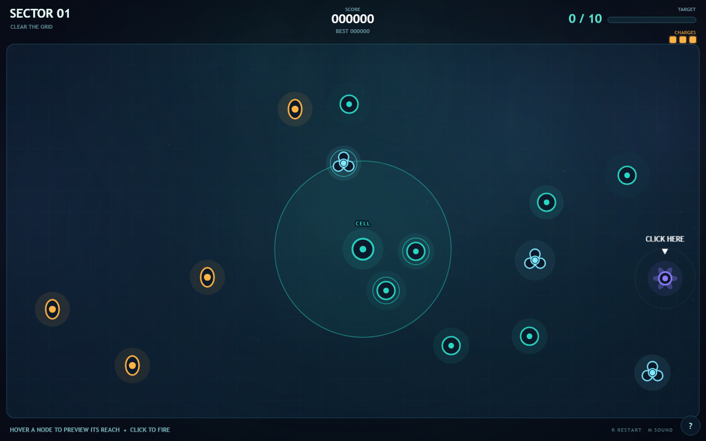
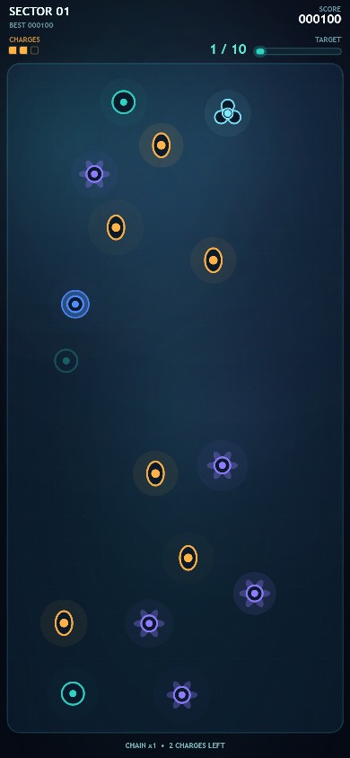
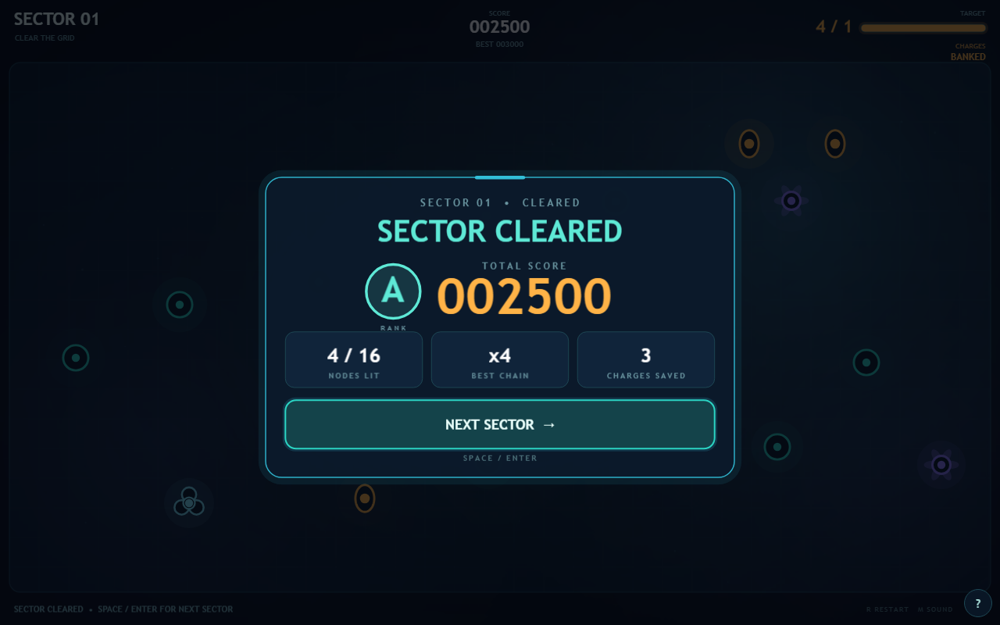

# Pulse Thief

A neon chain-reaction arcade game built with [Phaser 3](https://phaser.io). Click a node to inject energy, watch the pulse cascade through the network, and clear each sector's target before your charges run out.

Everything is generated in code: no image files, no sound files, no build step, no server. Phaser and the display font are bundled locally, so the game runs fully offline. The layout is responsive: it plays on a desktop browser, a tablet, or a phone in either orientation.



<p> &nbsp; </p>

## Play

Live: <https://shafiq1rwan.github.io/pulse-thief/> (deployed from `main` by GitHub Actions).

## Quick start

Double-click `index.html`. That's it.

If your browser blocks scripts on `file://` pages (rare, but some locked-down setups do), serve the folder instead:

```sh
# any of these work; pick what you have installed
python -m http.server 8000
npx serve .
```

Then open <http://localhost:8000>.

## Controls

| Input                     | Action                                                  |
| ------------------------- | ------------------------------------------------------- |
| Hover a node (mouse)      | Preview its reach: every node it would light up         |
| Click a node (mouse)      | Spend one charge, start a chain reaction                |
| Tap a node (touch)        | Select it and preview its reach                         |
| Tap it again (touch)      | Fire. Tapping empty space clears the selection          |
| `R`                       | Restart the run from sector 1                           |
| `M`                       | Toggle synthesized sound                                |
| `Space` / `Enter`         | Press the NEXT SECTOR / RETRY button                    |
| `?` button                | How-to-play panel                                       |

## How to play

- Each sector spawns a field of dormant nodes. You start with 3 charges.
- Clicking a node activates it. An activated node pulses energy to every dormant node within its radius, and those nodes pulse in turn.
- Clear the sector by activating the target number of nodes (62% of the field in sector 1, rising to 74% by sector 4). Leftover charges pay a bonus.
- Longer chains score more: each node in a chain is worth 100 × its position in the chain, capped at ×12.

### Node types

| Node    | Shape               | Colour     | Behaviour                                                   |
| ------- | ------------------- | ---------- | ----------------------------------------------------------- |
| Cell    | plain round         | teal       | Standard pulse radius                                       |
| Bloom   | six petals          | violet     | Larger pulse radius                                         |
| Trilobe | three lobes         | pale aqua  | Fires three long-range bolts in distinct directions         |
| Shell   | double ring         | deep blue  | Needs two hits; the outer shell fills on the first          |
| Seed    | warm pod            | amber      | Grants one extra charge when activated (max 8)              |

Types are shape-coded as well as colour-coded, so they read at a glance and without colour vision.

Every sector guarantees at least one battery, one amplifier and one splitter.

## Project layout

```
pulse-thief-phaser/
├── index.html              Full-viewport canvas host; help dialog; loads scripts in order
├── assets/css/style.css    Viewport, safe areas, help button and dialog
├── assets/fonts/fredoka.css  Fredoka (OFL) embedded as a data URI
├── vendor/phaser.min.js    Phaser 3.90.0 (bundled for offline use)
├── src/
│   ├── config.js           Tunables, palette, node tables, juice values
│   ├── audio.js            Web Audio tone synthesizer
│   ├── scenes/PulseScene.js  All gameplay, rendering, layout and HUD
│   ├── main.js             Boots Phaser, keeps the canvas sized to its box
│   └── ui.js               Help dialog (outside the canvas)
└── docs/
    ├── ARCHITECTURE.md     How the code fits together
    ├── GAME_DESIGN.md      Rules, scoring, balance knobs
    └── screenshot*.png     README images
```

Scripts are plain classic `<script>` tags, not ES modules, on purpose. Browsers block module imports on `file://`, and the whole point of this project is that it opens with a double-click.

## Screens

The canvas fills whatever space the page gives it and lays itself out per orientation. Radii, node spacing and node size scale with the playfield so density feels the same everywhere. Touch targets stay at or above 44 px.

The canvas is the whole page. It renders at the device's pixel ratio (capped at 3x), so text and lines are sharp on phones.

| Screen                  | Layout                                                  |
| ----------------------- | ------------------------------------------------------- |
| Desktop / landscape     | One HUD row: sector, score, charges + target bar        |
| Phone / tablet portrait | Two HUD rows, status line centred                       |
| Short landscape phone   | Same single HUD row; results card switches to two columns |

The only DOM outside the canvas is the `?` button (bottom-right) and its help dialog.

## Tweaking the game

All balance values live in `src/config.js` under `CONFIG`. Colours live in `COLORS`. Change a number, refresh the page.

See [docs/GAME_DESIGN.md](docs/GAME_DESIGN.md) for what each knob does, and [docs/ARCHITECTURE.md](docs/ARCHITECTURE.md) before touching `PulseScene.js`.

## Deploying

Pushing to `main` runs `.github/workflows/pages.yml`: a syntax check, then a GitHub Pages deploy of `index.html`, `assets/`, `src/` and `vendor/`. One-time setup in the repo: Settings → Pages → Source: **GitHub Actions**.

## Status

Prototype. Difficulty and balance have not been playtested. See [CHANGELOG.md](CHANGELOG.md).

## License

MIT. Phaser is MIT-licensed by Photon Storm; see `vendor/`. The Fredoka typeface is by Milena Brandão, under the SIL Open Font License 1.1, embedded in `assets/fonts/`.
